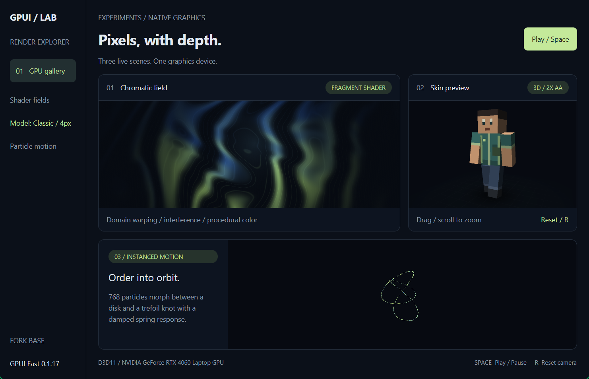
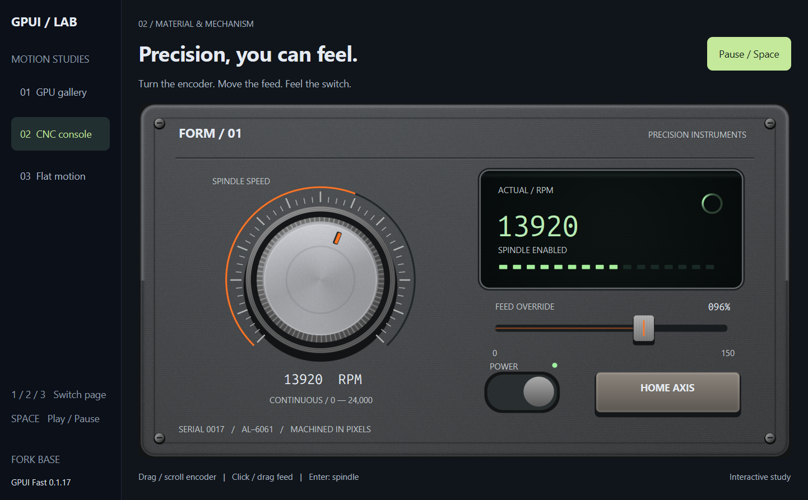
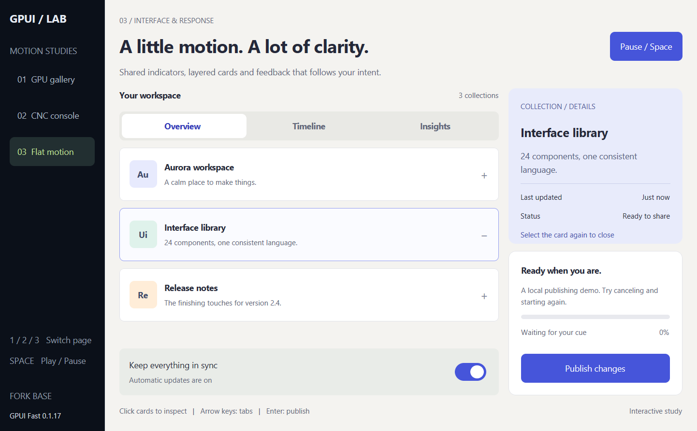

# GPU viewports on GPUI Fast 0.1.17

The fork keeps GPUI's Windows D3D11 renderer and adds `gpui_windows::DirectXDynamicTexture`, an owning GPU render target that the existing sprite pipeline can sample. This complements `gpui_wgpu::WgpuDynamicTexture`; it does not replace the Windows platform with wgpu.

The design follows the same-device render-to-texture approach already used by GPUI Fast's wgpu implementation. A producer uses a private D3D11 deferred context, and GPUI executes its command list on the renderer's immediate context with `RestoreContextState = TRUE`. There is no second device, shared-handle bridge, staging texture, pixel upload, image encoding or GPU readback in the frame loop. The UI still has the normal cost of sampling and compositing the viewport texture. Command recording and state restoration also have a cost; no D3D11-versus-wgpu speedup is implied.



## Run the gallery

From the source workspace, using its pinned Rust toolchain and dependencies:

```powershell
cargo run -p gpui_perf --release --example gpu_gallery
```

Windows only. Drag the model to orbit, scroll to zoom, press **R** to reset, and **Space** or the playback button to pause/resume. Click the model type in the left sidebar to switch between classic (4px arms) and slim (3px arms). `--paused` freezes motion at startup. The operating system reduced-motion preference also starts paused and keeps decorative movement disabled when playback is enabled; interaction targets update immediately. Shader compilation errors are printed and displayed in the window.

The three scenes are:

- **Chromatic field:** an HLSL fragment shader with domain warping, animated interference bands and procedural color.
- **Skin preview:** original classic/slim OBJ meshes loaded by `tobj`, with standard Minecraft dimensions and skin UVs, separate outer clothing/hat layers, alpha cutouts, a vertex buffer, perspective camera, depth attachment, lighting, ground grid and articulated limbs. The viewport renders at **2x physical width and height** and GPUI downsamples it, reducing edge aliasing at four times the pixel workload of 1x rendering. Skin textures use point sampling to retain their intended pixel detail. The bundled explorer skin, mesh and shaders are original Apache-2.0 assets. HMCL's skin preview informed the dimensions, layer and interaction checklist; its Java implementation and artwork were not copied.
- **Instanced motion:** 768 particles in one instanced draw. Vertex shaders evaluate a disk-to-trefoil morph, depth and a damped spring response. Particle positions are not uploaded every frame.

Load a modern 64x64 skin, or a higher-resolution square skin whose dimensions are a multiple of 64 (up to 4096):

```powershell
cargo run -p gpui_perf --release --example gpu_gallery -- --skin C:/path/to/skin.png --slim
```

Legacy 64x32 conversion and capes are outside this demo. The default skin is authored for classic UVs; a slim skin can use `--skin` together with `--slim`.

One-shot diagnostic images and CPU submission measurements:

```powershell
cargo run -p gpui_perf --release --example gpu_gallery -- --frames 300 --capture-dir target/gpu-gallery-images --report target/gpu-gallery-report.json
```

`--capture-dir` deliberately performs **one diagnostic readback per visited GPU scene** and saves PNGs. This is separate from the interactive rendering path. `--frames` closes the demo after that many view renders. Reported CPU p50/p95 values sum recording and submission of the selected page's GPU viewports (three for scenes, one for CNC, none for the native flat page), skip 20 warmup samples, and exclude GPU execution, GPUI composition, present and screenshot export. They are not FPS or comparative backend benchmarks.


## Interactive UI motion studies

Use the sidebar or **1 / 2 / 3** to switch between the original GPU scenes, the CNC console and the flat workspace. Launch either study directly:

```powershell
cargo run -p gpui_perf --release --example gpu_gallery -- --page cnc
cargo run -p gpui_perf --release --example gpu_gallery -- --page flat
```



[Recorded CNC interactions](images/gpu-gallery-cnc.gif).

The **CNC console** combines an original procedural HLSL material with native GPUI labels and input regions. It includes anodized brushed stock, chamfered edges, slotted fasteners, turned aluminium, a fluted encoder, engraved ticks, an enamel pointer, recessed glass, load LEDs and a metal momentary button. These are analytic shading effects, rather than a physically simulated CNC machine or a new general-purpose material engine.

- Drag the encoder vertically or scroll it to change the spindle speed. **Left / Right** adjust it from the keyboard.
- Click or drag the feed rail; its input uses the current viewport bounds and remains aligned after resize/DPI changes. Focus the rail and use **Left / Right** for keyboard adjustment.
- Toggle the power rocker or press **Enter** to enable/disable the spindle. The display, LEDs and spindle indicator respond together.
- Hold **Home axis** to depress its cap and label; release to restore it and center both controls. The pressed response and release use different damping rates.



[Recorded flat UI interactions](images/gpu-gallery-flat.gif).

The **flat workspace** uses GPUI text, quads and paths. Its content scrolls in smaller windows to keep controls reachable. It has an interruptible shared tab indicator, staggered card responses, a layered collection inspector, an animated switch, a cancelable local progress sequence and a dismissible completion notification. Click the same collection again to close its inspector. The publishing sequence is a local simulation and does not send data. **Left / Right** switch tabs; **Enter** starts/cancels the local sequence. Focusable controls have visible focus outlines and keyboard activation.

UI responses use the analytic critically damped spring solution, preserving position and velocity on retargeting. Card staggering also retargets existing springs rather than resetting their coordinates. Native elements move through a small prepaint-offset wrapper: text and hitboxes receive the same translation after layout. Progress and switch geometry are painted directly; no width/height layout interpolation is involved. GPUI still constructs and submits its scene on the CPU; these native animations are not independent compositor-thread animations.

**Space** / the playback button freezes the animation clock. Controls remain usable while paused and apply their new state immediately. Reduced motion removes spatial transitions and decorative rotation. The flat page stops requesting frames once its responses settle; the CNC page does so when its spindle is off and the controls have settled. Input handlers only notify the view; animation-frame scheduling stays inside render to avoid GPUI 0.1.17's current-view panic.

Implementation is confined to the fork-owned example: `motion.rs` (state/response/translation), `studies.rs` (native UI/input), `cnc.hlsl` (material) and small gallery/renderer hooks. The renderer API and upstream GPUI files need no additional changes for these studies.

## Use the Windows API

```rust,ignore
let target = gpui_windows::DirectXDynamicTexture::new(window, physical_size)?;
// Create your shaders, vertex/index buffers, depth texture, etc. on target.device().
target.render(window, |context, color_target| {
    // Bind a complete pipeline on this deferred context, including viewport,
    // render targets, shaders and buffers. Record draws here.
    // Output premultiplied BGRA8 UNORM; alpha = 1 is sufficient for opaque scenes.
    Ok(())
})?;
// During the GPUI element's paint phase:
target.paint(window, bounds)?;
```

Compute physical dimensions from the element bounds times `window.scale_factor()`. Recreate the target and depth attachment on resize/DPI changes. The example caps preview resolution at 4096 pixels per axis. The API validates positive dimensions up to the D3D11 16384-pixel limit, and device allocation may still fail under memory pressure.

The owner is neither `Send` nor `Sync`; use it on the window thread. Do not retain or submit work on the supplied deferred context outside the callback, recursively enter GPUI, or create resources from another device. The callback starts with default context state each frame. A returned error or panic discards its commands. External side effects such as direct calls on a separately acquired immediate context cannot be rolled back.

The target starts transparent. Successful renders invalidate GPUI's texture content version, allowing retained views and cached layers to see the new contents. `paint` uses GPUI's existing clipping, opacity and ordering. Notify any other windows that display the target. Drop releases both the backend entry and core texture metadata. After device replacement, `is_current()` becomes false and rendering fails before invoking the producer. Recreate both the target and every producer resource made on its old device. The gallery demonstrates this lifecycle.

## Platform and maintenance boundary

Only `crates/gpui_windows/src/fast/dynamic_textures.rs` contains the new renderer implementation; `gpui_windows.rs` adds one public export. This extends the documented dynamic-texture API exception, without changing core GPUI scene types or replacing the platform renderer. Examples live in the fork-owned `gpui_perf` crate. No synchronization-check script is added.

Linux/web wgpu backends already have a same-context render target (`WgpuDynamicTexture`), but context acquisition and producer shaders must be integrated per platform. This change does not add a common graphics API, a macOS Metal render-target owner, or portability of these HLSL examples. Windows execution does not establish Linux/macOS runtime compatibility. A subsequent portable layer can use wgpu on its existing backends and native D3D11/Metal adapters where GPUI uses them; moving Windows fully to wgpu is a separate platform integration project.

## Validation

The pause/reset/drag/zoom handlers notify their view and never call `request_animation_frame` from input callbacks. That method in the 0.1.17 baseline expects a current rendered view and panics when used outside paint/prepaint, despite its broader documentation. The demo requests continuing animation only from `Render::render`. The callback regression test deliberately invokes playback/reset outside paint.

The native interactive check also exercised mouse playback toggles, Space playback toggles, dragging while paused, R reset (restoring identical model pixels), Classic/Slim switching, zoom and window resize. RGB screenshot differences confirmed motion while playing and identical shader pixels across paused captures.

The UI studies additionally passed seven example tests: refresh-rate independence, velocity-preserving reversal and settling, rapid tab retargeting without coordinate jumps, reduced-motion/job completion, skin mesh invariants, callbacks outside paint (including feed bounds and paused controls), and native HLSL compilation. Release build and Clippy with warnings denied for the example passed. Window-message checks exercised encoder reversal, feed movement, momentary press/release, power, tabs, card inspection, sync, the full local publishing sequence, pause stability and scrolling at the minimum window size. The recorded GIFs use captures of the running application window. Capture cadence and desktop occlusion affect their timing; they are visual demonstrations, not performance measurements.

The local Windows verification used the unmodified published 0.1.17 core/platform crates with this fork's Windows renderer sources, under the registry release manifests. This avoids needing the source workspace's unreleased Git dependencies for the Windows check. It does not establish that the complete source workspace or other operating systems build. Its manifest-generated dependency graph differs from the source workspace lockfile, as does the normal upstream release workflow.


```powershell
cargo test -p gpui_windows --features test-support fast::dynamic_textures::gpu_tests -- --nocapture
cargo test -p gpui_perf --example gpu_gallery
```

The tests use the D3D11 WARP device for deterministic offscreen checks: initialized contents, real submitted pixel values, immediate-context state restoration, callback error/panic discard, resource retirement, invalid sizes and device replacement. A hardware run of the gallery is still needed to verify driver behavior and interaction.

## Design references

- GPUI Fast's existing GPU texture owner: `crates/gpui_wgpu/src/fast/dynamic_textures.rs` (same context, ordinary sprite sampling, refresh-on-success).
- [GPUI Fast dynamic texture API, PR 86](https://github.com/longbridge/gpui-fast/pull/86).
- [GPUI Fast context access, PR 102](https://github.com/longbridge/gpui-fast/pull/102).
- [Microsoft: deferred contexts](https://learn.microsoft.com/en-us/windows/win32/direct3d11/overviews-direct3d-11-render-multi-thread-render).
- [Microsoft: ExecuteCommandList and context-state restoration](https://learn.microsoft.com/en-us/windows/win32/api/d3d11/nf-d3d11-id3d11devicecontext-executecommandlist).

- [HMCL skin preview reference](https://github.com/HMCL-dev/HMCL/tree/main/HMCL/src/main/java/org/jackhuang/hmcl/ui/skin).

No external renderer implementation was copied. The demo mesh and shaders are original.
